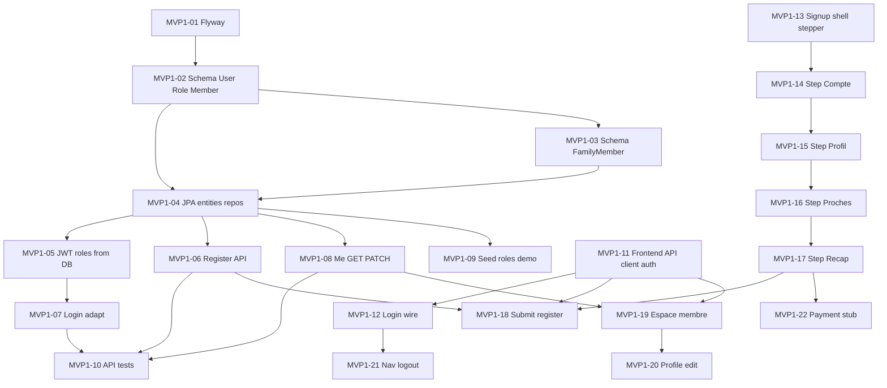

# MVP 1 — Fine-grained issues

Identity and onboarding for RHDP Canada. A member can complete signup (**Compte → Profil → Proches → Récapitulatif**), log in, and use a basic espace membre. **Paiement** is a stub that hands off to MVP 2.

## Scope

| In scope | Out of scope |
| --- | --- |
| `User`, `Role`, `USER_ROLES`, `Member`, `FamilyMember` | Stripe Checkout, charges, payments |
| Flyway migrations | News CMS, notifications, events |
| Register, login, `/api/me` GET+PATCH | Forgot-password email flow |
| Multi-step `/adhesion` + `/espace-membre` | Full admin console |

**Suggested labels:** `mvp-1`, `backend` \| `frontend` \| `infra`, `priority:P0` \| `priority:P1`

## Dependency graph

## Recommended implementation order

1. MVP1-01 → MVP1-02 → MVP1-03 → MVP1-04
2. MVP1-05 → MVP1-07 (in parallel with MVP1-06, MVP1-08, MVP1-09 after 04)
3. MVP1-10 once 06–08 exist
4. MVP1-11, then MVP1-13 → MVP1-14 → … → MVP1-18 (backend register must be ready for 18)
5. MVP1-12, MVP1-19 → MVP1-20, MVP1-21, MVP1-22

---

## Infra / data

### MVP1-01 — Introduce Flyway and disable schema auto-update

| Field | Value |
| --- | --- |
| Area | infra / backend |
| Priority | P0 |
| Depends on | — |

**Work**

- Add Flyway dependency to [`backend/pom.xml`](../backend/pom.xml).
- Set `spring.jpa.hibernate.ddl-auto=validate` (or `none`) in [`application.yml`](../backend/src/main/resources/application.yml).
- Keep the test profile working (H2 + Flyway or test migrations).

**Acceptance**

- App starts against empty Postgres only via migrations.
- CI `./mvnw verify` stays green.

---

### MVP1-02 — Migration: users, roles, user_roles, reshape members

| Field | Value |
| --- | --- |
| Area | backend |
| Priority | P0 |
| Depends on | MVP1-01 |

**Work**

- Create `V1__identity.sql` (or equivalent) with:
  - `users` — uuid PK, email unique, password_hash, enabled, created_at
  - `roles` — uuid PK, name unique
  - `user_roles` — user_id, role_id
  - `members` — uuid PK, user_id unique FK, first_name, last_name, phone, address/ville, status, joined_at
- Drop email / password / displayName from the scaffold `members` model.

**Acceptance**

- Migration applies cleanly on a fresh DB.
- Unique constraints on email and role name.

---

### MVP1-03 — Migration: family_members

| Field | Value |
| --- | --- |
| Area | backend |
| Priority | P0 |
| Depends on | MVP1-02 |

**Work**

- Table `family_members`: uuid, member_id FK, first_name, last_name, relationship, birth_date nullable.

**Acceptance**

- FK to `members`.
- Cascade delete with member, or document orphan policy.

---

### MVP1-04 — JPA entities and repositories for identity + family

| Field | Value |
| --- | --- |
| Area | backend |
| Priority | P0 |
| Depends on | MVP1-02, MVP1-03 |

**Work**

- Entities/repos under `ca.rhdp.canada`: `User`, `Role`, `Member`, `FamilyMember`.
- Replace current [`Member.java`](../backend/src/main/java/ca/rhdp/canada/member/Member.java) that stores credentials.

**Acceptance**

- Repositories can find user by email and member by user id.
- No password on `Member`.

---

## Auth / API

### MVP1-05 — Load authorities from DB in JWT security filter

| Field | Value |
| --- | --- |
| Area | backend |
| Priority | P0 |
| Depends on | MVP1-04 |

**Work**

- Update [`JwtAuthenticationFilter`](../backend/src/main/java/ca/rhdp/canada/security/JwtAuthenticationFilter.java) / [`JwtService`](../backend/src/main/java/ca/rhdp/canada/security/JwtService.java).
- Carry role claims in the token **or** load roles from `user_roles` in the filter.
- Stop hardcoding `ROLE_MEMBER` only. Support `MEMBER` and `ADMIN`.

**Acceptance**

- User with `ADMIN` gets `ROLE_ADMIN`.
- Member-only user does not.

---

### MVP1-06 — Register endpoint `POST /api/auth/register`

| Field | Value |
| --- | --- |
| Area | backend |
| Priority | P0 |
| Depends on | MVP1-04 |

**Work**

- Body: email, password, firstName, lastName, phone, city/address, optional `proches[]`.
- Create `User` (enabled, BCrypt), assign `MEMBER`, create `Member`, create `FamilyMember` rows.
- Reject duplicate email with 409.

**Acceptance**

- Register returns 201 + access token (or 201 then client logs in).
- DB has user + member + proches.
- Duplicate email fails cleanly.

---

### MVP1-07 — Adapt login to User table

| Field | Value |
| --- | --- |
| Area | backend |
| Priority | P0 |
| Depends on | MVP1-05 |

**Work**

- Change [`AuthController`](../backend/src/main/java/ca/rhdp/canada/auth/AuthController.java) to authenticate against `users`.
- Disabled users get 401/403.
- Response includes roles, or client uses `/me`.

**Acceptance**

- Existing curl login flow works with the new schema.
- Wrong password → 401.

---

### MVP1-08 — Expand `GET /api/me` and add `PATCH /api/me`

| Field | Value |
| --- | --- |
| Area | backend |
| Priority | P0 |
| Depends on | MVP1-04 |

**Work**

- Me payload: email, roles, member profile fields, proches summary.
- PATCH updates firstName, lastName, phone, address (not email/password in MVP 1).

**Acceptance**

- Authenticated member reads/updates own profile only.

---

### MVP1-09 — Seed roles + demo member via Flyway/seeder

| Field | Value |
| --- | --- |
| Area | backend |
| Priority | P1 |
| Depends on | MVP1-04 |

**Work**

- Seed roles `MEMBER`, `ADMIN`.
- Keep env-gated demo user ([`DemoMemberSeeder`](../backend/src/main/java/ca/rhdp/canada/member/DemoMemberSeeder.java) rewritten for User+Member) using `DEMO_USER_*`.

**Acceptance**

- Empty password still skips demo.
- With password, login works against demo.

---

### MVP1-10 — Backend tests for register / login / me / security

| Field | Value |
| --- | --- |
| Area | backend |
| Priority | P0 |
| Depends on | MVP1-06, MVP1-07, MVP1-08 |

**Work**

- Extend [`ApiSecurityTest`](../backend/src/test/java/ca/rhdp/canada/ApiSecurityTest.java) or add focused tests:
  - public register / login
  - protected me
  - unauth → 401
  - register validation

**Acceptance**

- `./mvnw verify` covers happy path + auth denial.

---

## Frontend

### MVP1-11 — Shared API client + token storage

| Field | Value |
| --- | --- |
| Area | frontend |
| Priority | P0 |
| Depends on | — |

**Work**

- Add `frontend/lib/api.ts` (base URL from [`public-config.ts`](../frontend/lib/public-config.ts)).
- Auth storage (token in `sessionStorage` or `localStorage`).
- Helpers: `login`, `register`, `getMe`, `patchMe`.
- Centralize `Authorization: Bearer`.

**Acceptance**

- Single place for fetch + JSON error handling.
- No token in the URL.

---

### MVP1-12 — Wire connexion page to real login

| Field | Value |
| --- | --- |
| Area | frontend |
| Priority | P0 |
| Depends on | MVP1-07, MVP1-11 |

**Work**

- Update [`login-form.tsx`](../frontend/components/login-form.tsx) / [`connexion/page.tsx`](../frontend/app/connexion/page.tsx) to call the API.
- On success, redirect to `/espace-membre`.
- Show API errors in French.
- Member button = primary path.
- Admin button: login, then route to `/espace-membre` (or `/admin` placeholder) only if `ADMIN` role is present; otherwise French error.
- Link « Adhérer » → `/adhesion`.
- « Mot de passe oublié ? » → disabled / tooltip « Bientôt disponible » (no email reset in MVP 1).

**Acceptance**

- Demo credentials log in end-to-end.
- Invalid creds show an error.
- No more “does not call the server” copy.

---

### MVP1-13 — Signup route shell + 5-step stepper

| Field | Value |
| --- | --- |
| Area | frontend |
| Priority | P0 |
| Depends on | — |

**Work**

- New `/adhesion` page matching mockups in `Mockup images/`.
- Stepper: Compte \| Profil \| Proches \| Récapitulatif \| Paiement.
- Layout: form column + « Votre total » sidebar (50 $ + 10 $ + proches 0 $ = 60 $; event note).
- Client wizard state (React state or URL step).

**Acceptance**

- Stepper reflects current / completed steps.
- Sidebar totals match marketing copy.

---

### MVP1-14 — Signup step Compte

| Field | Value |
| --- | --- |
| Area | frontend |
| Priority | P0 |
| Depends on | MVP1-13 |

**Work**

- Fields: courriel, mot de passe (min 8).
- Continuer / Retour.
- Client validation (zod).

**Acceptance**

- Cannot advance with invalid email or short password.

---

### MVP1-15 — Signup step Profil

| Field | Value |
| --- | --- |
| Area | frontend |
| Priority | P0 |
| Depends on | MVP1-14 |

**Work**

- Fields: prénom, nom, téléphone, ville/province.
- Persist in wizard state.

**Acceptance**

- Back / forward keeps values.
- Required fields enforced.

---

### MVP1-16 — Signup step Proches

| Field | Value |
| --- | --- |
| Area | frontend |
| Priority | P0 |
| Depends on | MVP1-15 |

**Work**

- Show membre principal.
- « + Ajouter un proche » (facultatif, aucun frais).
- Collect first / last / relationship / optional birth date.
- Update sidebar proches count (still 0,00 $).

**Acceptance**

- Add / remove proches in wizard.
- Skip allowed with zero proches.

---

### MVP1-17 — Signup step Récapitulatif

| Field | Value |
| --- | --- |
| Area | frontend |
| Priority | P0 |
| Depends on | MVP1-16 |

**Work**

- Read-only summary: courriel, membre principal, ville, proches.
- Continuer.

**Acceptance**

- Matches entered data.
- Back to edit works.

---

### MVP1-18 — Submit registration from Récapitulatif → account created

| Field | Value |
| --- | --- |
| Area | frontend |
| Priority | P0 |
| Depends on | MVP1-06, MVP1-11, MVP1-17 |

**Work**

- On Continuer from récap: `POST /api/auth/register` with full payload.
- Store token; advance to Paiement stub (or land there with session).
- Handle duplicate email.

**Acceptance**

- New user exists in DB.
- Client is authenticated after success.

---

### MVP1-19 — Espace membre shell

| Field | Value |
| --- | --- |
| Area | frontend |
| Priority | P0 |
| Depends on | MVP1-08, MVP1-11 |

**Work**

- Route `/espace-membre` (client guard: no token → `/connexion`).
- Greeting + profile summary from `GET /api/me`.
- French copy; reuse existing brand styles.

**Acceptance**

- Authenticated visit works.
- Unauthenticated redirects.

---

### MVP1-20 — Profile edit in espace membre

| Field | Value |
| --- | --- |
| Area | frontend |
| Priority | P1 |
| Depends on | MVP1-08, MVP1-19 |

**Work**

- Form to PATCH name / phone / city.
- Success feedback.

**Acceptance**

- Reload shows persisted values.

---

### MVP1-21 — Header: auth-aware nav + logout

| Field | Value |
| --- | --- |
| Area | frontend |
| Priority | P1 |
| Depends on | MVP1-12 |

**Work**

- Update [`site-header.tsx`](../frontend/components/site-header.tsx):
  - Logged in → Espace membre + Déconnexion
  - Logged out → Connexion / Adhérer
- Logout clears token.

**Acceptance**

- Nav reflects session without a full redesign.

---

### MVP1-22 — Paiement step stub (hand-off to MVP 2)

| Field | Value |
| --- | --- |
| Area | frontend |
| Priority | P1 |
| Depends on | MVP1-17 |

**Work**

- Step 5 UI: show total 60,00 $ and message that payment arrives in the next release.
- CTA « Aller à mon espace » → `/espace-membre`.
- Do not call Stripe.

**Acceptance**

- Signup completes without payment.
- No PaymentIntent usage from the UI.

---

## Exit criteria

- Fresh `docker compose up` + Flyway migrations create the identity schema.
- User can complete `/adhesion` through récap; account + member (+ proches) persisted.
- Login / logout works; `/espace-membre` shows and can edit profile.
- Roles loaded from DB; demo user still seedable.
- CI frontend lint/build + backend verify pass.
- No Stripe checkout required to finish MVP 1.
